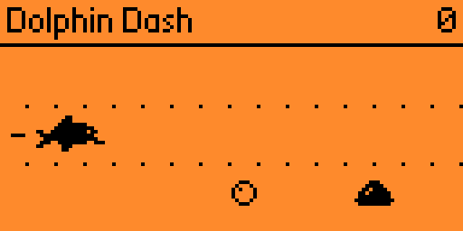

# Dolphin Dash

Every bubble is worth three points. Every bubble has a rock right behind it.

Swim through three lanes on your Flipper Zero. Stay in a clear lane to earn a point for each rock you pass, or dart in for a bubble and get out before the rock arrives. The game picks up speed after 6, 12, and 18 rocks. A wipeout ends the round. Your best score lasts until you close the game.

## Controls

- **OK** starts a dive or retries after a wipeout.
- **Up** and **Down** move one lane per press.
- **Back** exits the game.

## Play on a Flipper Zero

Check the firmware version in qFlipper and download the matching game file.

| Official firmware | Dolphin Dash v0.1 download |
| --- | --- |
| 1.5.1 | [dolphin_dash-1.5.1.fap](https://github.com/rasulkireev/dolphin-dash/releases/download/v0.1/dolphin_dash-1.5.1.fap) |
| 1.4.3 | [dolphin_dash-1.4.3.fap](https://github.com/rasulkireev/dolphin-dash/releases/download/v0.1/dolphin_dash-1.4.3.fap) |

Rename the downloaded file to `dolphin_dash.fap`. In qFlipper's file manager, copy it into `apps/Games` on the microSD card. Open **Apps → Games → Dolphin Dash** on the Flipper.

If the game stops opening after an upgrade from 1.4.3 to 1.5.1, replace the old game file with the 1.5.1 build. The two firmware versions use different app APIs.

## Build from source

From the repository root, run the official [uFBT build tool](https://github.com/flipperdevices/flipperzero-ufbt) with `ufbt` to build the game or `ufbt launch` to install and run it over USB. Use an SDK compatible with your device firmware.
